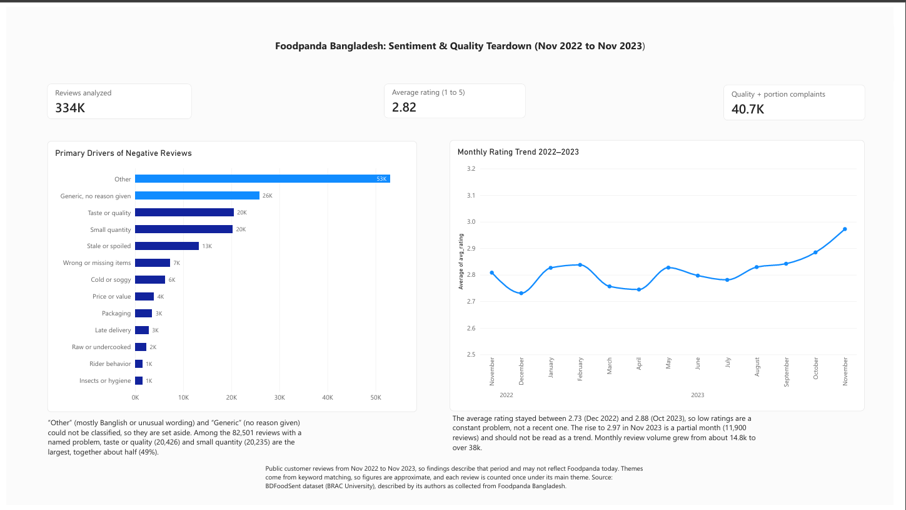
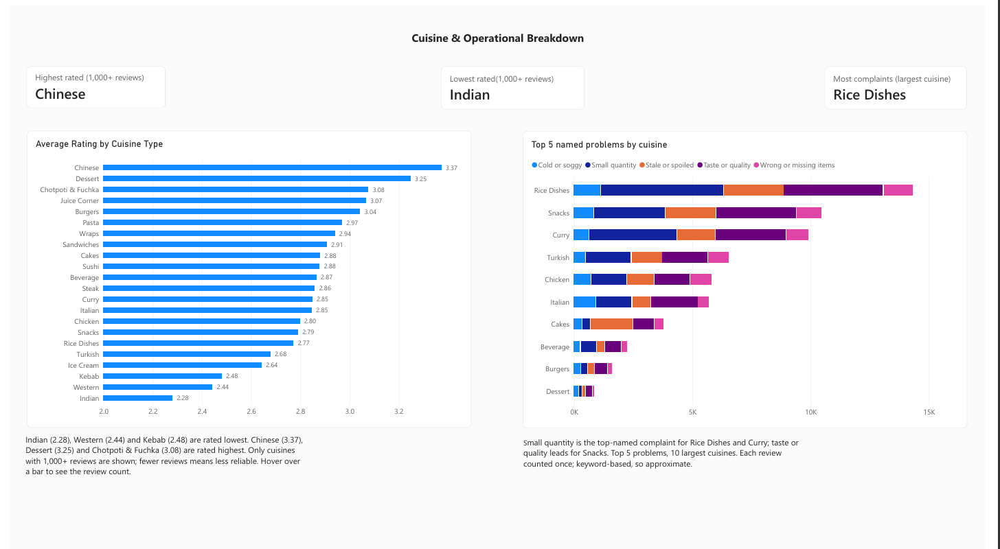

# What drives bad ratings? Foodpanda Bangladesh review analysis

**Tools:** MySQL, Excel, Power BI  |  **Data:** 334,119 restaurant reviews, Nov 2022 to Nov 2023

## Business question

> What are the main problems behind low ratings on Foodpanda Bangladesh, and which should be fixed first?

## Key findings

1. **Low ratings are constant, not recent.** 48.3% of reviews are 1 or 2 stars, and the monthly average stays between 2.73 and 2.88 from Nov 2022 to Oct 2023 (overall average 2.82).
2. **Food is the main complaint, not delivery.** Among the 82,501 bad reviews that name a specific problem, taste or quality (20,426) and small quantity (20,235) make up about half (49%). Stale or spoiled food adds 13,171.
3. **Delivery themes are small in this data.** Late delivery is 1.7% and rider behavior 0.9% of bad reviews (keyword counts, probably undercounted because many reviews are written in Banglish).
4. **Cuisine matters more than city or month.** Among cuisines with 1,000+ reviews, Indian (2.28), Western (2.44) and Kebab (2.48) rate lowest; Chinese (3.37) and Dessert (3.25) rate highest. Dhaka, Chittagong and Sylhet are almost identical (2.80 to 2.83).

| Theme (one per review, 161,275 bad reviews) | Reviews | Share |
|---|---|---|
| Other (mostly Banglish or unusual wording) | 53,025 | 32.9% |
| Generic, no reason given | 25,749 | 16.0% |
| Taste or quality | 20,426 | 12.7% |
| Small quantity | 20,235 | 12.5% |
| Stale or spoiled | 13,171 | 8.2% |
| Wrong or missing items | 7,195 | 4.5% |
| Cold or soggy | 6,214 | 3.9% |
| Price or value | 3,860 | 2.4% |
| Packaging | 3,490 | 2.2% |
| Late delivery | 2,761 | 1.7% |
| Raw or undercooked | 2,282 | 1.4% |
| Rider behavior | 1,435 | 0.9% |
| Insects or hygiene | 1,432 | 0.9% |

## Dashboard




## Data

- **BDFoodSent** dataset (BRAC University, Mendeley Data): 334,119 restaurant reviews, described by its authors as collected from Foodpanda Bangladesh. The file itself has no platform column, so this is the authors' description and not something I could verify.
- Restaurant names are anonymized. Download the dataset from its Mendeley page (check its licence and credit the authors). The raw file is not included in this repo.

## Method

1. **Load and clean** (`01_setup.sql`): imported the CSV into MySQL (334,119 rows, 0 skipped). Dropped `updatedAt` and the constant `type` column.
2. **Check** (`02_data_checks.sql`): no duplicate review IDs; ratings run 1 to 5 (38.1% are 1-star); the `ratings` field holds overall, food and rider scores.
3. **Analyse** (`03_basic_analysis.sql`): average rating by month, city and cuisine; then tagged every 1 to 2 star review with **one theme** using keyword rules (first match wins, specific problems first).
4. **Visualise**: exported four small result tables and built a two-page Power BI dashboard.
## Recommendations 

| Problem | Suggested action | Impact | Effort |
|---|---|---|---|
| Small quantity (12.5%) | Show portion size (grams or pieces) on item pages; flag items with repeated quantity complaints | High | Medium |
| Taste or quality, stale food (20.9% combined) | Track each restaurant's share of these complaints and review repeat offenders | High | Medium |
| Wrong or missing items (4.5%) | Add an order checklist for restaurants and a one-tap "missing item" report | Medium | Low |
| Late delivery (1.7%) | Lower priority based on this data | Low | n/a |

## Proposed experiment 

- **Hypothesis:** showing portion size on item pages will reduce 1 to 2 star ratings caused by quantity complaints, because expectations will match what arrives.
- **Groups:** randomly split users; control sees the current page, treatment sees portion size.
- **Main metric:** share of orders rated 1 or 2 stars. **Guardrail:** checkout conversion must not fall.
- **Duration:** 2 to 4 weeks, with sample size set by a sample size calculator.

## Limitations

- Data is from **Nov 2022 to Nov 2023** (Nov 2023 is partial, 11,900 reviews), so findings describe that period and not today.
- Themes come from **keyword matching**. About a third of bad reviews are "Other", mostly written in Banglish, and another 16% give no reason. Counts are approximate, and each review has one theme only.
- In this data the **overall rating equals the food rating in every review**, so food problems cannot be separated from platform problems by scores. I used the review text instead.
- The **rider score** exists for only 59.7% of reviews, varying from 2.4% to 93.7% by month, for an unknown reason. Reviews with and without it have similar average ratings (2.83 vs 2.80).
- Reviews are self-selected and the data is about **80% Dhaka**.

## Repository structure

```text
├── 01_setup.sql             # Database schema and table setup
├── 02_data_checks.sql       # Validation queries and data integrity checks
├── 03_basic_analysis.sql    # Keyword tagging rules and sentiment aggregations
├── cuisine.csv              # Aggregated rating data by cuisine type
├── monthly.csv              # Monthly rating trends (2022–2023)
├── theme_ranking.csv        # Overall dissatisfaction complaint volume
├── theme_by_cuisine.csv     # Complaint drivers breakdown cross-tabbed by cuisine
├── dashboard_page1.png      # Power BI Dashboard Page 1 (Executive Summary)
├── dashboard_page2.png      # Power BI Dashboard Page 2 (Cuisine Breakdown)
└── foodpanda_dashboard.pdf  # Static PDF export of the complete dashboard
```
